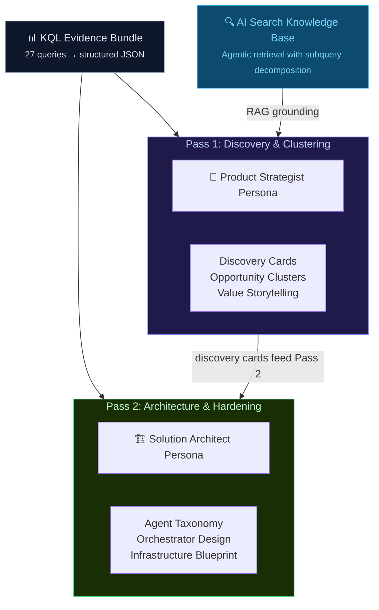
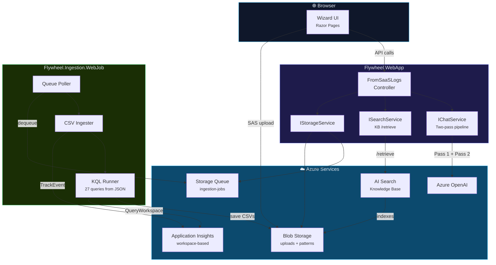
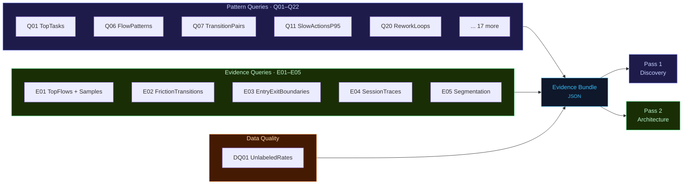

<p align="center">
  
</p>

<p align="center">
  <a href="#quick-start"></a>
  <a href="#authentication"></a>
  <a href="#kql-query-library"></a>
  <a href="#two-pass-generation"></a>
  <a href="LICENSE.txt"></a>
</p>

<p align="center">
  <strong>Flywheel</strong> transforms raw SaaS usage logs into actionable AI agent architecture recommendations.<br/>
  Upload CSV logs from any SaaS system — Dynamics 365, Salesforce, M365, or custom apps — and get<br/>
  evidence-grounded Discovery Cards and production-hardened architecture blueprints.
</p>

---

## Why Flywheel

Organizations sitting on SaaS usage logs rarely know *what their users actually do* — which workflows are repeated, where friction lives, or which tasks are ripe for AI agent automation. Manual log analysis doesn't scale, and building agent architectures without behavioral evidence leads to generic, low-impact solutions.

Flywheel solves this with a **KQL-first compression** approach: instead of dumping raw logs into an LLM, it first reduces millions of telemetry rows into structured behavioral evidence using 27 purpose-built KQL queries. This small, rich evidence bundle then feeds a two-pass generation pipeline that produces both product-ready discovery and engineering-ready architecture.

---

## Two-Pass Generation

Flywheel uses two sequential LLM passes with different personas, temperatures, and grounding strategies. This design was validated through A/B testing that showed each pass excels at different things, and combining them produces results neither achieves alone.



| | Pass 1: Discovery | Pass 2: Architecture |
|:---|:---|:---|
| **Persona** | Product strategist | Solution architect |
| **Temperature** | 0.7 (creative) | 0.3 (precise) |
| **Grounding** | Evidence + AI Search KB | Evidence + Pass 1 output |
| **Strength** | Semantic clustering, value framing, persona language | Explicit contracts, failure modes, operational rigor |
| **Audience** | Product, Sales Leadership, GM | CTO, Platform Engineering, Foundry/MCP teams |
| **Output** | 8–12 discovery cards grouped into Quick Wins / Platform Bets / Strategic | Agent taxonomy, memory models, HITL gates, infra blueprint, Mermaid diagrams |

The two passes form a natural flywheel:

```
Raw Logs → RAG Discovery → Candidate Agent Backlog → Hardened Architecture → Production Signals → Back to Discovery
```

---

## Architecture



---

## Project Structure

```
Flywheel.WebApp/                        ASP.NET Core web app
├── Configuration/Options.cs            StorageOptions, AzureOpenAIOptions, AzureSearchOptions
├── Controllers/FromSaaSLogs.cs         Upload, enqueue, two-pass generation
├── Models/                             ChatMessageDto, IngestionJobMessage
├── Services/
│   ├── StorageService.cs               Azure Blob + Queue (IStorageService)
│   ├── SearchService.cs                AI Search Knowledge Base retrieval (ISearchService)
│   ├── AzureOpenAIChatService.cs       Two-pass LLM pipeline (IChatService)
│   ├── Prompts.cs                      Separated Discovery + Architecture prompts
│   └── Utilities.cs                    Session helpers, CSV evidence builder
├── Pages/                              Razor Pages (wizard UI, dashboard)
└── wwwroot/                            Static assets

Flywheel.Ingestion.WebJob/              Background worker
├── Program.cs                          Queue polling → CSV profiling → ingestion → KQL → artifacts
├── Queries/
│   └── kql-library.json                27 externalized KQL queries
└── Settings.job                        WebJob schedule config
```

---

## KQL Query Library

All queries are externalized in [`Queries/kql-library.json`](Flywheel.Ingestion.WebJob/Queries/kql-library.json) — edit without recompiling.



### Pattern Queries (Q01–Q22)

| ID | Name | What It Reveals |
|:---|:-----|:----------------|
| Q01 | TopTasks | Most-executed tasks ranked by volume and user count |
| Q02 | TopActions | Action breakdown per task/role with duration stats |
| Q03 | UsersByTask | Adoption breadth — how many users touch each task |
| Q04 | RoleAdoption | Execution volume per role |
| Q05 | SessionSummary | Session-level step count and duration |
| Q06 | FlowPatterns | Most common action sequences (workflow fingerprints) |
| Q07 | TransitionPairs | Action → Action transition frequencies |
| Q08 | FunnelStepPositions | What action happens at each step position |
| Q09 | DropOffShortSessions | 1–2 step sessions (bounce rate) |
| Q10 | LongRunningSessions | Longest sessions by wall-clock time |
| Q11 | SlowActionsP95 | Performance bottlenecks (P95 duration) |
| Q12 | TimeBetweenSteps | Think-time gaps between consecutive steps |
| Q13 | HourlyHeatmap | Activity distribution by hour of day |
| Q14 | DailyTrendByTask | Daily execution trends for adoption tracking |
| Q15 | PowerUsers | Top users by execution count and task breadth |
| Q16 | EntryExit | First/last action per session (process boundaries) |
| Q17 | StepsDistribution | How many steps sessions typically take |
| Q18 | ActionDiversity | Distinct actions per task (complexity measure) |
| Q19 | TaskSwitching | Context switching — tasks per session |
| Q20 | ReworkLoops | Repeated actions indicating friction or rework |
| Q21 | ActionSetSize | Behavioral variety per session |
| Q22 | TopFlowsByRole | Most common flows segmented by role |

### Evidence Queries (E01–E05)

| ID | Name | Why It Matters |
|:---|:-----|:---------------|
| E01 | TopFlowsWithSamples | Top flows **with sample session IDs** for LLM grounding |
| E02 | FrictionTransitions | Step gaps + repeated actions pinpoint **where agents should intervene** |
| E03 | EntryExitBoundaries | Process boundaries define **safe agent trigger placement** |
| E04 | RepresentativeSessionTraces | Full step-by-step traces from 10 busiest sessions for **concrete grounding** |
| E05 | RoleTaskActionSegmentation | Role/task/action breakdown to scope **per-role vs. shared agents** |

---

## Quick Start

### Prerequisites

- [.NET 9 SDK](https://dot.net/download) (web app) / .NET 8 SDK (WebJob)
- [Azure CLI](https://learn.microsoft.com/cli/azure/install-azure-cli) — run `az login`
- Azure resources:

| Resource | Required RBAC |
|:---------|:-------------|
| Storage Account (Blob + Queue) | `Storage Blob Data Contributor` + `Storage Queue Data Contributor` |
| Application Insights | `Monitoring Metrics Publisher` |
| Log Analytics Workspace | `Log Analytics Reader` |
| Azure OpenAI | `Cognitive Services OpenAI User` |
| AI Search (optional) | `Search Index Data Reader` on your identity |

For AI Search agentic retrieval, you also need:

| On Resource | Assign To | Role |
|:---|:---|:---|
| Azure OpenAI | AI Search managed identity | `Cognitive Services OpenAI User` |
| Storage Account | AI Search managed identity | `Storage Blob Data Reader` |

### 1. Clone

```bash
git clone https://github.com/your-org/flywheel.git
cd flywheel
```

### 2. Configure

Create `Flywheel.WebApp/appsettings.Development.json`:

```json
{
  "AzureOpenAI": {
    "Endpoint": "https://your-resource.openai.azure.com/",
    "DeploymentName": "gpt-4o",
    "TenantId": "your-tenant-id"
  },
  "AzureSearch": {
    "Endpoint": "https://your-search.search.windows.net",
    "KnowledgeBaseName": "flywheel-kb",
    "Enabled": true
  },
  "Storage": {
    "AccountName": "yourstorageaccount"
  }
}
```

Create `Flywheel.Ingestion.WebJob/appsettings.Development.json`:

```json
{
  "AzureOpenAI": {
    "Endpoint": "https://your-resource.openai.azure.com/",
    "DeploymentName": "gpt-4o",
    "TenantId": "your-tenant-id"
  },
  "Storage": {
    "AccountName": "yourstorageaccount"
  },
  "ApplicationInsights": {
    "ConnectionString": "InstrumentationKey=..."
  },
  "LogAnalytics": {
    "WorkspaceId": "your-workspace-guid"
  }
}
```

### 3. Set up AI Search Knowledge Base (optional)

In the Azure portal:

1. Go to your AI Search service → **Agentic retrieval** → **Knowledge sources**
2. Create a **blob knowledge source** pointing to your `patterns` container
3. Create a **Knowledge Base** named `flywheel-kb` linking to the knowledge source + your Azure OpenAI LLM deployment
4. Ensure the Search service managed identity has the RBAC roles listed above

If you skip this, set `"Enabled": false` in the config — Flywheel still works with prompt-only generation.

### 4. Run

```bash
cd Flywheel.WebApp && dotnet run          # Terminal 1
cd Flywheel.Ingestion.WebJob && dotnet run # Terminal 2
```

Open **https://localhost:7249** and follow the wizard.

---

## AI Search Integration

Flywheel uses Azure AI Search's **agentic retrieval** — the Knowledge Base decomposes complex queries into focused subqueries, runs them in parallel with semantic reranking, and returns unified grounding context.

The integration is a direct REST call to the Knowledge Base `/retrieve` endpoint (no experimental SDK types):

```
POST https://{search-service}/knowledgebases/{kb-name}/retrieve?api-version=2025-11-01-preview
```

The Knowledge Base's blob indexer automatically indexes evidence CSVs from the `patterns` container. When "Generate Use Cases" is clicked, `SearchService` sends a retrieval query describing the analysis needed, gets back semantically ranked grounding data, and passes it to Pass 1.

To compare results with and without AI Search:

```json
{ "AzureSearch": { "Enabled": false } }  // prompt-only (Pass 1 + Pass 2 still run)
{ "AzureSearch": { "Enabled": true  } }  // KB-grounded discovery
```

---

## Authentication

All Azure SDK calls use **Microsoft Entra ID** — zero API keys.

| Environment | Credential |
|:------------|:-----------|
| Local dev | `DefaultAzureCredential` → picks up `az login` / Visual Studio / VS Code |
| Azure App Service | Managed Identity (system-assigned) |

---

## Deployment

### Web App → Azure App Service

```bash
cd Flywheel.WebApp && dotnet publish -c Release -o ./publish
```

App Service configuration:

```
AzureOpenAI__Endpoint = https://your-resource.openai.azure.com/
AzureOpenAI__DeploymentName = gpt-4o
Storage__AccountName = yourstorageaccount
AzureSearch__Endpoint = https://your-search.search.windows.net
AzureSearch__KnowledgeBaseName = flywheel-kb
```

### WebJob → Continuous WebJob

Deploy under `App_Data/jobs/continuous/flywheel-ingestion/`.

Additional settings:

```
ApplicationInsights__ConnectionString = InstrumentationKey=...
LOG_ANALYTICS_WORKSPACE_ID = your-workspace-guid
```

---

## Customization

### Adding KQL Queries

Edit `Queries/kql-library.json`:

```json
{
  "id": "Q23",
  "name": "MyNewQuery",
  "purpose": "What this query reveals",
  "appendTo": "patterns.myQuery",
  "outputColumns": ["Col1", "Col2", "Count"],
  "suffix": "\n_raw\n| summarize Count=count() by Col1, Col2\n| top 100 by Count desc",
  "usesSorted": false
}
```

Restart the WebJob — no recompilation needed.

### Tuning Parameters

| Setting | Default | Description |
|:--------|:--------|:------------|
| `Flywheel:SampleRows` | 100 | Rows sampled for schema inference |
| `Flywheel:MinQueries` | 22 | Minimum queries after AOAI + library merge |
| `Flywheel:MaxDequeue` | 5 | Retries before poison queue |
| `Flywheel:QueryLibraryPath` | `Queries/kql-library.json` | Path to KQL library |
| `AzureSearch:Enabled` | true | Toggle AI Search grounding on/off |
| `AzureSearch:KnowledgeBaseName` | flywheel-kb | Knowledge Base name |

---

## Troubleshooting

| Symptom | Likely Cause | Fix |
|:--------|:-------------|:----|
| Queue stuck | WebJob deployed as Triggered | Redeploy as **Continuous** |
| 403 on blob upload | Missing RBAC | Grant `Storage Blob Data Contributor` |
| Empty KQL results | Ingestion latency | WebJob retries 5× with 2s delays |
| "No evidence CSVs found" | Processing incomplete | Check `JobStatus`; look for `.done` blob |
| AOAI timeout | Model overloaded or endpoint changed | Verify endpoint in config; check Azure portal |
| KB indexer skill fails 403 | Search MI can't reach OpenAI | Grant `Cognitive Services OpenAI User` to Search MI |
| KB returns empty grounding | Index not populated | Run indexer manually; check blob indexer status in portal |
| `NullReferenceException` on MappingPlan | AOAI returned partial JSON | Fixed: null guard on `MappingLooksWeak` |
| `No such host` on OpenAI | Resource deleted or renamed | Update `AzureOpenAI:Endpoint` in config |

---

## Security

- **Zero secrets in source** — `appsettings.Development.json` is git-ignored
- **Entra ID everywhere** — Managed Identity in Azure, DefaultAzureCredential locally
- **Short-lived SAS tokens** — Upload URLs expire in 20 minutes (Create+Write only)
- **Server-side sessions** — Chat history in server memory, not cookies
- **Idempotent processing** — Lock blobs prevent duplicate execution
- **Poison queue** — Failed messages quarantined after configurable retries
- **No experimental SDK types** — AI Search KB called via stable REST + bearer token

---

<p align="center">
  <sub>MIT License · Built with ASP.NET Core, Azure OpenAI, Azure AI Search, and KQL</sub>
</p>
