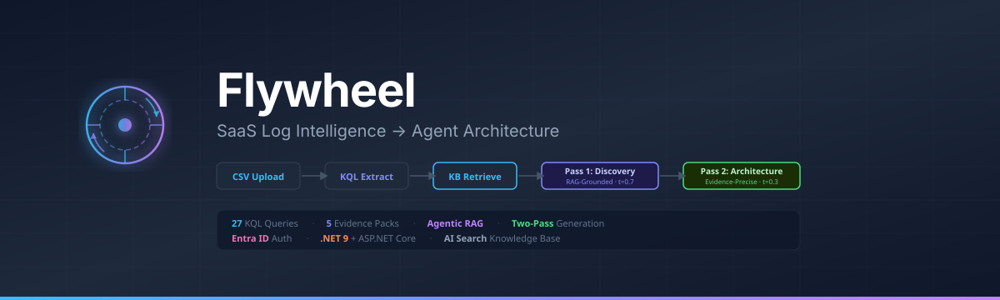
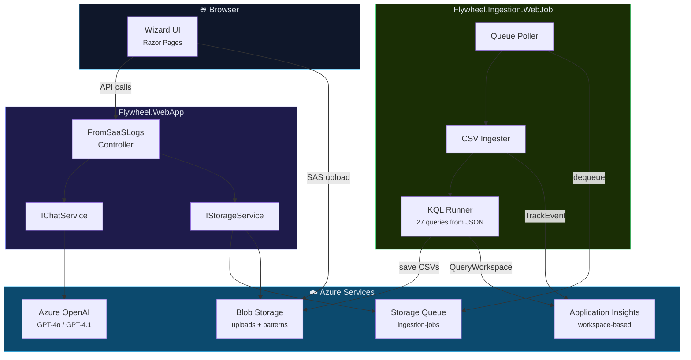
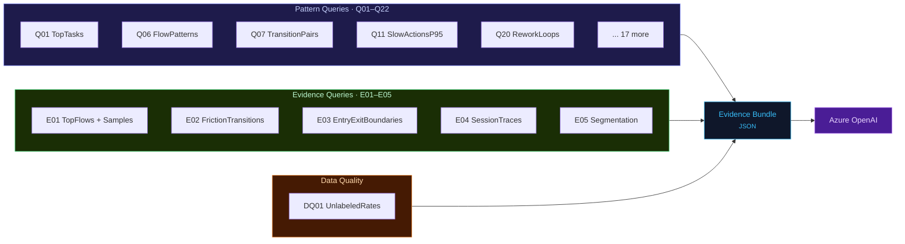

<p align="center">
  
</p>

<p align="center">
  <a href="#quick-start"></a>
  <a href="#authentication"></a>
  <a href="#kql-query-library"></a>
  <a href="LICENSE.txt"></a>
</p>

<p align="center">
  <strong>Flywheel</strong> transforms raw SaaS usage logs into actionable AI agent architecture recommendations.<br/>
  Upload CSV logs from any SaaS system — Dynamics 365, Salesforce, M365, or custom apps — and get<br/>
  evidence-grounded Discovery Cards and architecture blueprints powered by Azure OpenAI.
</p>

---

## The Problem

Organizations sitting on SaaS usage logs rarely know *what their users actually do* — which workflows are repeated, where friction lives, or which tasks are ripe for AI agent automation. Manual log analysis doesn't scale, and building agent architectures without behavioral evidence leads to generic, low-impact solutions.

## How Flywheel Solves It

Flywheel uses a **KQL-first compression** approach: instead of dumping raw logs into an LLM, it first reduces millions of telemetry rows into structured behavioral evidence using 27 purpose-built KQL queries. This small, rich evidence bundle then feeds Azure OpenAI to produce grounded, specific recommendations.


## What You Get

Flywheel generates four output sections from your logs:

| Section | What It Produces |
|:--------|:-----------------|
| **Discovery Cards** | 8–12 agent opportunity cards with persona, trigger, evidence citations, KPI estimates, risks, and priority |
| **Architecture** | Per-card agent type, orchestration pattern, tools, memory model, human-in-the-loop gates, and evaluation plan |
| **Multi-Agent Design** | Orchestrator topology, communication model, conflict resolution, scalability, and AI Foundry MCP integration |
| **Infrastructure** | Full Azure service map with scale assumptions, throughput targets, security model, and DR strategy |

---

## Architecture



---

## Project Structure

```
Flywheel.WebApp/                        ASP.NET Core web app
├── Configuration/Options.cs            Strongly-typed StorageOptions + AzureOpenAIOptions
├── Controllers/FromSaaSLogs.cs         Upload SAS, enqueue, generate use cases
├── Models/                             ChatMessageDto, IngestionJobMessage
├── Services/
│   ├── StorageService.cs               Azure Blob + Queue operations (IStorageService)
│   ├── AzureOpenAIChatService.cs       Azure OpenAI completions (IChatService)
│   ├── Prompts.cs                      Centralized prompt templates
│   └── Utilities.cs                    Session helpers, CSV evidence builder
├── Pages/                              Razor Pages (wizard UI, dashboard)
└── wwwroot/                            Static assets (CSS, JS, fonts, icons)

Flywheel.Ingestion.WebJob/              Background worker
├── Program.cs                          Queue polling → CSV profiling → ingestion → KQL → artifacts
├── Queries/
│   └── kql-library.json                27 externalized KQL queries (edit without recompile)
└── Settings.job                        WebJob schedule config
```

---

## KQL Query Library

All queries live in [`Queries/kql-library.json`](Flywheel.Ingestion.WebJob/Queries/kql-library.json) — add, remove, or tune queries without touching code.



### Pattern Queries (Q01–Q22)

| ID | Name | What It Reveals |
|:---|:-----|:----------------|
| Q01 | TopTasks | Most-executed tasks ranked by volume and user count |
| Q02 | TopActions | Action breakdown per task/role with duration stats |
| Q03 | UsersByTask | Adoption breadth — how many users touch each task |
| Q04 | RoleAdoption | Execution volume per role |
| Q05 | SessionSummary | Session-level step count and duration |
| Q06 | FlowPatterns | Most common action sequences (workflow fingerprints) |
| Q07 | TransitionPairs | Action → Action transition frequencies |
| Q08 | FunnelStepPositions | What action happens at each step position |
| Q09 | DropOffShortSessions | 1–2 step sessions (abandon / bounce rate) |
| Q10 | LongRunningSessions | Longest sessions by wall-clock time |
| Q11 | SlowActionsP95 | Performance bottlenecks (P95 duration) |
| Q12 | TimeBetweenSteps | Think-time gaps between consecutive steps |
| Q13 | HourlyHeatmap | Activity distribution by hour of day |
| Q14 | DailyTrendByTask | Daily execution trends for adoption tracking |
| Q15 | PowerUsers | Top users by execution count and task breadth |
| Q16 | EntryExit | First/last action per session (process boundaries) |
| Q17 | StepsDistribution | How many steps sessions typically take |
| Q18 | ActionDiversity | Distinct actions per task (complexity measure) |
| Q19 | TaskSwitching | Context switching — tasks per session |
| Q20 | ReworkLoops | Repeated actions indicating friction or rework |
| Q21 | ActionSetSize | Behavioral variety per session |
| Q22 | TopFlowsByRole | Most common flows segmented by role |

### Evidence Queries (E01–E05)

These give the LLM concrete, grounded context beyond aggregates:

| ID | Name | Why It Matters |
|:---|:-----|:---------------|
| E01 | TopFlowsWithSamples | Top flows **with sample session IDs** so the LLM can reason about real examples |
| E02 | FrictionTransitions | Step gaps + repeated actions pinpoint **where agents should intervene** |
| E03 | EntryExitBoundaries | Process boundaries tell the LLM **where to safely place agent triggers** |
| E04 | RepresentativeSessionTraces | Full step-by-step traces from the 10 busiest sessions for **concrete grounding** |
| E05 | RoleTaskActionSegmentation | Role/task/action breakdown to decide **per-role vs. shared agents** |

---

## Quick Start

### Prerequisites

- [.NET 9 SDK](https://dot.net/download) (web app) / .NET 8 SDK (WebJob)
- [Azure CLI](https://learn.microsoft.com/cli/azure/install-azure-cli) — run `az login`
- Azure resources with RBAC roles assigned to your identity:

| Resource | Required Role |
|:---------|:-------------|
| Storage Account (Blob + Queue) | `Storage Blob Data Contributor` + `Storage Queue Data Contributor` |
| Application Insights | `Monitoring Metrics Publisher` |
| Log Analytics Workspace | `Log Analytics Reader` |
| Azure OpenAI | `Cognitive Services OpenAI User` |

### 1. Clone

```bash
git clone https://github.com/your-org/flywheel.git
cd flywheel
```

### 2. Configure

Create `Flywheel.WebApp/appsettings.Development.json` (git-ignored):

```json
{
  "AzureOpenAI": {
    "Endpoint": "https://your-resource.openai.azure.com/",
    "DeploymentName": "gpt-4o",
    "TenantId": "your-tenant-id"
  },
  "Storage": {
    "AccountName": "yourstorageaccount"
  }
}
```

Create `Flywheel.Ingestion.WebJob/appsettings.Development.json`:

```json
{
  "AzureOpenAI": {
    "Endpoint": "https://your-resource.openai.azure.com/",
    "DeploymentName": "gpt-4o",
    "TenantId": "your-tenant-id"
  },
  "Storage": {
    "AccountName": "yourstorageaccount"
  },
  "ApplicationInsights": {
    "ConnectionString": "InstrumentationKey=..."
  },
  "LogAnalytics": {
    "WorkspaceId": "your-workspace-guid"
  }
}
```

### 3. Run

```bash
# Terminal 1 — Web app
cd Flywheel.WebApp
dotnet run

# Terminal 2 — Background worker
cd Flywheel.Ingestion.WebJob
dotnet run
```

Open **https://localhost:7249** and follow the wizard.

---

## Authentication

Flywheel uses **Microsoft Entra ID** exclusively — zero API keys in code or config.

| Environment | Credential | How |
|:------------|:-----------|:----|
| **Local dev** | Azure CLI | `az login` before running |
| **Azure App Service** | Managed Identity | Assign system-assigned MI, grant RBAC roles |

---

## Deployment

### Web App → Azure App Service

```bash
cd Flywheel.WebApp
dotnet publish -c Release -o ./publish
```

Set App Service configuration (double-underscore notation):

```
AzureOpenAI__Endpoint = https://your-resource.openai.azure.com/
AzureOpenAI__DeploymentName = gpt-4o
Storage__AccountName = yourstorageaccount
```

### WebJob → Continuous WebJob

Deploy as a **Continuous** WebJob under `site/wwwroot/App_Data/jobs/continuous/flywheel-ingestion/`.

Additional settings:

```
ApplicationInsights__ConnectionString = InstrumentationKey=...
LOG_ANALYTICS_WORKSPACE_ID = your-workspace-guid
```

---

## Customization

### Adding KQL Queries

Edit `Queries/kql-library.json` and add a new entry:

```json
{
  "id": "Q23",
  "name": "MyNewQuery",
  "purpose": "What this query reveals",
  "appendTo": "patterns.myQuery",
  "outputColumns": ["Col1", "Col2", "Count"],
  "suffix": "\n_raw\n| summarize Count=count() by Col1, Col2\n| top 100 by Count desc",
  "usesSorted": false
}
```

Restart the WebJob — no recompilation needed.

### Tuning Parameters

| Setting | Default | Description |
|:--------|:--------|:------------|
| `Flywheel:SampleRows` | 100 | Rows sampled for schema inference |
| `Flywheel:MinQueries` | 22 | Minimum queries after AOAI + library merge |
| `Flywheel:InitialVisibilityMinutes` | 30 | Queue message visibility timeout |
| `Flywheel:MaxDequeue` | 5 | Retries before poison queue |
| `Flywheel:QueryLibraryPath` | `Queries/kql-library.json` | Path to KQL library |

---

## Troubleshooting

| Symptom | Likely Cause | Fix |
|:--------|:-------------|:----|
| Queue stuck / never processes | WebJob deployed as Triggered | Redeploy as **Continuous** |
| 403 on blob upload | Missing RBAC | Grant `Storage Blob Data Contributor` |
| Empty KQL results | Ingestion latency | WebJob retries 5× with 2s delays |
| "No evidence CSVs found" | Processing incomplete | Check `JobStatus`; look for `.done` blob |
| AOAI returns weak mapping | Unusual CSV schema | Heuristic fallback activates automatically |

---

## Security

- **Zero secrets in source** — `appsettings.Development.json` is git-ignored; production uses App Service config
- **Entra ID everywhere** — Managed Identity in Azure, Azure CLI locally
- **Short-lived SAS tokens** — Upload URLs expire in 20 minutes (Create+Write only)
- **Server-side sessions** — Chat history in server memory, not cookies
- **Idempotent processing** — Lock blobs prevent duplicate execution
- **Poison queue** — Failed messages quarantined after configurable retries

---

<p align="center">
  <sub>MIT License · Built with ASP.NET Core, Azure OpenAI, and KQL</sub>
</p>
